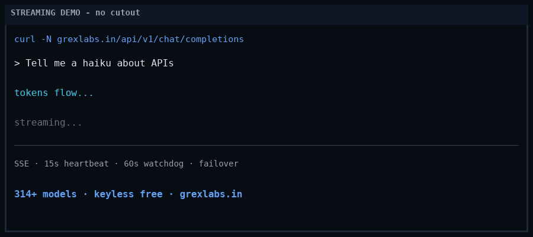

<p align="center">
  <a href="https://www.grexlabs.in">
    
  </a>
</p>

<p align="center">
  
  
  
  
  
  <a href="./LICENSE"></a>
  
</p>

<h1 align="center">
  
  GrexLabs — Free AI API
</h1>

<p align="center">
  <b>The free, keyless, OpenAI-compatible AI API platform</b><br>
  314+ LLMs · Web search · Image generation · Streaming without cutout
</p>

<p align="center">
  <b>🔑 No API key for free models</b> · <b>⚡ Instant responses</b> · <b>🌊 SSE with zero cutout</b> · <b>🌏 India-first search</b> · <b>🎨 Free images</b>
</p>

<p align="center">
  <a href="https://www.grexlabs.in"><strong>🌐 Website</strong></a> ·
  <a href="https://www.grexlabs.in/docs"><strong>📚 Docs</strong></a> ·
  <a href="https://www.grexlabs.in/playground"><strong>🎮 Playground</strong></a> ·
  <a href="https://www.grexlabs.in/models"><strong>🧠 Models</strong></a> ·
  <a href="https://www.grexlabs.in/pricing"><strong>💎 Pricing</strong></a> ·
  <a href="https://www.grexlabs.in/llm.txt"><strong>🤖 llm.txt</strong></a> ·
  <a href="https://grexlabs.github.io"><strong>✨ Landing</strong></a>
</p>

<p align="center">
  <a href="https://www.grexlabs.in/playground">
    
  </a>
  <a href="https://github.com/Grexlabs/grexlabs">
    
  </a>
</p>

---

## 📑 Table of Contents

- [Why GrexLabs](#-why-grexlabs)
- [Ultra-Fast Quickstart](#-ultra-fast-quickstart)
- [Authentication & Key Policy](#-authentication--key-policy)
- [API Endpoints](#-api-endpoints)
- [Model Catalog — 314+ Models](#-model-catalog--314-models)
- [Free Models — Call Right Now](#-free-models--call-right-now)
- [Flagship Models — GPT-6.2 Astra & More](#-flagship-models--gpt-62-astra--more)
- [Streaming — No Cutout, Ever](#-streaming--no-cutout-ever)
- [Web Search API — India-First](#-web-search-api--india-first)
- [Image Generation API — Free](#-image-generation-api--free)
- [SDKs & Language Examples](#-sdks--language-examples)
- [Architecture](#-architecture)
- [GrexLabs vs Others](#-grexlabs-vs-others)
- [SEO · AEO · GEO Files](#-seo--aeo--geo-files)
- [Deploy Your Own Instance](#-deploy-your-own-instance)
- [FAQ](#-faq)
- [License](#-license)

---

## 🌟 Why GrexLabs

**GrexLabs** (https://www.grexlabs.in) is a **free AI API platform** that gives you **one OpenAI-compatible endpoint** in front of **314+ large language models** from **25+ providers** — plus a **free web search API** and a **free image generation API**.

| 💡 Capability | ✅ What you get |
|---|---|
| 🔑 **Keyless free tier** | All `:free` models (31 free IDs + `auto:free`) work with **zero key, zero signup, zero credit card** — unlimited |
| 🧠 **314+ models** | GPT-6.2 Astra, GPT-6 Astra, Claude Fable 5.2, Gemini 4 Carbon, Grok 4.7, DeepSeek V4 Pro, Qwen 3.8 Max, GLM-5.3, Kimi K3, Nemotron, Llama, Mistral + more |
| 🔌 **3 API formats** | OpenAI `/v1/chat/completions` · Anthropic `/v1/messages` · Google Gemini `/v1/generateContent` |
| 🌊 **No-cutout streaming** | SSE with 15 s heartbeats, 60 s stall watchdog, guaranteed `data: [DONE]` — the response never dies mid-answer |
| ⚡ **Fast responses** | Multi-provider auto-failover, 12 s per-attempt budget, first tokens typically in 1–3 s |
| 🌏 **Web search API** | Bing → DuckDuckGo → Google → Wikipedia chain, **India-first** (`region=IN`), no key, unlimited |
| 🎨 **Image generation** | OpenAI-compatible `/v1/images/generations`, **free & keyless**, t2i + **image-to-image**, multi-provider failover, `url` or `b64_json` |
| 🛠 **Tools, vision, thinking** | Function calling, image analysis, reasoning modes, temperature/max_tokens control |
| 📈 **Always up** | 25+ upstream providers with sequential retry — if one fails, the next takes over |

> **TL;DR — copy-paste start (no key):**
> ```bash
> curl https://www.grexlabs.in/api/v1/chat/completions \
>   -H "Content-Type: application/json" \
>   -d '{"model":"auto:free","messages":[{"role":"user","content":"Hello!"}]}'
> ```

---

## 🚀 Ultra-Fast Quickstart

### cURL

```bash
# Free model — no API key, no signup
curl https://www.grexlabs.in/api/v1/chat/completions \
  -H "Content-Type: application/json" \
  -d '{
    "model": "auto:free",
    "messages": [{"role": "user", "content": "Hello!"}],
    "temperature": 0.7
  }'
```

### Python

```python
import requests

r = requests.post(
    "https://www.grexlabs.in/api/v1/chat/completions",
    headers={"Content-Type": "application/json"},   # no key needed for :free models
    json={
        "model": "auto:free",
        "messages": [{"role": "user", "content": "Hello!"}],
    },
)
print(r.json()["choices"][0]["message"]["content"])
```

### JavaScript / Node.js

```javascript
const r = await fetch("https://www.grexlabs.in/api/v1/chat/completions", {
  method: "POST",
  headers: { "Content-Type": "application/json" },
  body: JSON.stringify({
    model: "auto:free",
    messages: [{ role: "user", content: "Hello!" }],
  }),
});
const data = await r.json();
console.log(data.choices[0].message.content);
```

### Flagship model (valid `sk-gl-` key required)

```bash
curl https://www.grexlabs.in/api/v1/chat/completions \
  -H "Authorization: Bearer sk-gl-YOUR-KEY" \
  -H "Content-Type: application/json" \
  -d '{
    "model": "openai/gpt-6.2-astra",
    "messages": [{"role": "user", "content": "Hello!"}],
    "temperature": 0.7
  }'
```

---

## 🔐 Authentication & Key Policy

| Request | `:free` models (e.g. `auto:free`) | All other models (GPT-6.2 Astra, Claude, …) |
|---|---|---|
| **No key** | ✅ works, unlimited | ❌ `401` |
| **Wrong / placeholder key** | ✅ works | ❌ `401` |
| **Valid `sk-gl-…` key** | ✅ works | ✅ works |

- Free model IDs always end with **`:free`** — or just use **`auto:free`** for automatic best-free-model selection.
- Issued keys look like `sk-gl-1712345678-a1b2c3` (dashboard: https://www.grexlabs.in/dashboard).
- Keys can also be sent as `x-api-key: <key>` or `?key=<key>`.
- **Never hard-code keys in client-side apps** — use the keyless `:free` models in browsers.

---

## 🧩 API Endpoints

| Method | Endpoint | Format | Auth | Description |
|---|---|---|---|---|
| `POST` | `/api/v1/chat/completions` | **OpenAI** | keyless for `:free` | Chat completions, streaming, tools, vision |
| `POST` | `/gen/v1/chat/completions` | **OpenAI** | keyless for `:free` | Alias of the same endpoint |
| `POST` | `/api/v1/messages` | **Anthropic** | keyless for `:free` | Messages API with system prompts, content blocks, tool_use |
| `POST` | `/api/v1/generateContent` | **Gemini** | keyless for `:free` | contents/parts, inline_data, `?alt=sse` streaming |
| `GET` | `/api/v1/models` | JSON list | none | All **314 models** with context length & pricing |
| `GET` | `/gen/models` | OpenAI list | none | OpenAI-style model list |
| `GET` | `/api/v1/search` | JSON | **none** | Web search (India-first), `q`, `max_results`, `region` |
| `POST` | `/api/search` | JSON | **none** | Legacy search endpoint |
| `POST` | `/api/v1/images/generations` | **OpenAI Images** | **none** | Free image generation t2i + i2i (`prompt`, `image_url`/`image_b64`, `n`, `size`, `model`, `response_format`) |
| `POST` | `/api/v1/moderate` | JSON | none | Content safety check |

Full request/response schemas: **https://www.grexlabs.in/docs**

---

## 🧠 Model Catalog — 314+ Models

Browse all models live: **https://www.grexlabs.in/models** · API: `GET /api/v1/models`

| Tier | Count | Examples |
|---|---|---|
| ⭐ **Flagship** | 50+ | `openai/gpt-6.2-astra`, `openai/gpt-6-astra`, `anthropic/claude-fable-5.2`, `google/gemini-4-carbon`, `x_ai/grok-4.7`, `deepseek/deepseek-v4-pro`, `manus/manus-agent` |
| 🔵 **Standard** | 150+ | GPT-4.1/4o/4-turbo, Claude 3.7/4, Gemini 2.5, DeepSeek V3, Llama 3.1/4, Qwen 3, Mistral Large |
| ⚪ **Lightweight** | 60+ | Mini/Nano/Flash/Haiku variants — fast & cheap |
| 👁 **Vision** | 25+ | `text+image→text` models for image analysis |
| 🛠 **Specialized** | 25+ | Coder, Reasoning, Deep-Research, Agent models |
| 🆓 **Free (`:free`)** | **31 + `auto:free`** | `gpt-5.5:free`, `claude-opus-5:free`, `deepseek-v4:free`, `nemotron-3-ultra-550b-a55b:free`, … |

> Every model entry includes `id`, `name`, `context_length`, `architecture.modality` and `pricing` — free models have `"prompt": "0"`.

---

## 🆓 Free Models — Call Right Now

**No API key. No signup. No credit card.** Just POST:

```bash
curl https://www.grexlabs.in/api/v1/chat/completions \
  -H "Content-Type: application/json" \
  -d '{"model":"auto:free","messages":[{"role":"user","content":"Write a haiku about the Ganges"}]}'
```

Highlights of the free tier:

- 🥇 `auto:free` — automatic best-free-model selection (vision, reasoning, tools supported)
- 🧠 `openai/gpt-5.5:free`, `openai/o3-pro:free`, `openai/gpt-5.6:free`
- 🤖 `anthropic/claude-opus-5:free`, `anthropic/claude-sonnet-5:free`
- 💎 `google/gemini-4-pro:free`, `google/gemini-3.2-flash:free`
- 🚀 `x_ai/grok-5:free`, `deepseek/deepseek-v4:free`, `deepseek/deepseek-r2:free`
- 🧩 `alibaba/qwen4-max:free`, `zhipu/glm-5.3:free`, `moonshotai/kimi-k4:free`
- ⚡ `nvidia/nemotron-3-ultra-550b-a55b:free`, `particle-ai/particle-1:free`, `google/gemma-4-31b-it:free`

---

## ⭐ Flagship Models — GPT-6.2 Astra & More

Top premium models (valid `sk-gl-` key required):

| Model ID | Name | Strength |
|---|---|---|
| `openai/gpt-6.2-astra` | **GPT-6.2 Astra** | Max reasoning, 400K context |
| `openai/gpt-6-astra` | **GPT-6 Astra** | Deep thinking |
| `openai/gpt-6-astra-pro` / `-fast` / `-ultra` / `-mini` / `-nano` | **GPT-6 Astra family** | Every speed/quality point |
| `openai/gpt-6.1-sol` / `openai/gpt-6.1-terra` | GPT-6.1 Sol / Terra | High reasoning |
| `anthropic/claude-fable-5.2` | Claude Fable 5.2 | Max effort |
| `anthropic/claude-opus-5.5` | Claude Opus 5.5 | Adaptive thinking |
| `anthropic/claude-sonnet-5.5` | Claude Sonnet 5.5 | Extended thinking |
| `google/gemini-4-carbon` | Gemini 4 Carbon | High thinking |
| `google/gemini-4-argon` / `-hydrogen` / `-neon` | Gemini 4 family | Advanced reasoning |
| `x_ai/grok-4.7` | Grok 4.7 | Expert reasoning |
| `deepseek/deepseek-v4-pro` | DeepSeek V4 Pro | Reasoning |
| `alibaba/qwen3.8-max` | Qwen 3.8 Max | Thinking mode |
| `zhipu/glm-5.3-deep` | GLM-5.3 Deep | Deep reasoning |
| `moonshotai/kimi-k3.1-pro` | Kimi K3.1 Pro | Thinking mode |
| `mistralai/mistral-large-4` | Mistral Large 4 | High reasoning |
| `manus/manus-agent` | Manus Agent | Autonomous agent |
| `openai/deep-research` · `google/gemini-deep-research` · `anthropic/claude-research` · `perplexity/perplexity-deep-research` | **Deep Research family** | Long-horizon research |

---

## 🌊 Streaming — No Cutout, Ever

<p align="center">
  
</p>

GrexLabs streaming is engineered so a response **never stops mid-answer**:

- **15-second SSE heartbeats** (`: ping`) keep the connection alive through slow generations
- **60-second stall watchdog** detects dead upstreams and fails over instead of hanging
- **Guaranteed terminator** — every stream ends with `data: [DONE]`
- **Multi-provider failover** — 12 s per-attempt budget, 120 s total, clean cancellation
- **Tool calls preserved** — `finish_reason: "tool_calls"` streams with `delta.tool_calls`

```bash
curl -N https://www.grexlabs.in/api/v1/chat/completions \
  -H "Content-Type: application/json" \
  -d '{"model":"auto:free","messages":[{"role":"user","content":"Tell me a long story"}],"stream":true}'
```

---

## 🌏 Web Search API — India-First

```bash
curl "https://www.grexlabs.in/api/v1/search?q=india%20cricket%20news&max_results=5&region=IN"
```

- **No key, unlimited**
- Engine chain (8 s budget): **Bing RSS → Bing HTML → DuckDuckGo → Google basic → Wikipedia**
- **India-first**: `mkt=en-IN`, `cc=IN`, `Accept-Language: en-IN`, default `region=IN`
- Response: `{ success, query, engine, region, total, count, items[], results[], engines[], timestamp }`
- Each item: `{ rank, title, url, domain, favicon, snippet }`
- Playground: https://www.grexlabs.in/search-playground

---

## 🎨 Image Generation API — Free (t2i + i2i)

```bash
# Text-to-image
curl https://www.grexlabs.in/api/v1/images/generations \
  -H "Content-Type: application/json" \
  -d '{"prompt":"A futuristic city at sunset, cinematic","size":"1024x1024","model":"auto","n":1}'
```

```bash
# Image-to-image (public source URL → AI DRAW)
curl https://www.grexlabs.in/api/v1/images/generations \
  -H "Content-Type: application/json" \
  -d '{"prompt":"make the sky sunset orange, keep everything else","image_url":"https://example.com/source.png","size":"1024x1024"}'
```

```bash
# Image-to-image (base64 → freeapi Flux Kontext)
curl https://www.grexlabs.in/api/v1/images/generations \
  -H "Content-Type: application/json" \
  -d '{"prompt":"add a hat","image_b64":"<base64>","model":"flux-dev"}'
```

```json
{ "created": 1712345678, "provider": "ai-draw", "data": [ { "url": "https://gitee-ai.su.bcebos.com/v1/public/temp/....png" } ] }
```

- **Free & keyless** — works for everyone, instantly
- **Multi-provider fallback**: AI DRAW → freeapi → a0 → seinari (auto failover)
- Params: `prompt` (required), `n` (1–4), `size`, `model` (`auto|flux|flux-dev|turbo|fast|quality`), `response_format` (`url|b64_json`)
- **Image-to-image**: `image_url` (public URL) or `image_b64` (raw base64)
- List models: `GET /api/v1/images/generations`

---

## 🧰 SDKs & Language Examples

Works with **any HTTP client** and every OpenAI SDK — just change `baseURL`:

```python
# openai python sdk
from openai import OpenAI
client = OpenAI(base_url="https://www.grexlabs.in/api/v1", api_key="sk-gl-YOUR-KEY")  # or "free" for :free models
print(client.chat.completions.create(
    model="auto:free",
    messages=[{"role": "user", "content": "Hello!"}],
).choices[0].message.content)
```

```javascript
// openai node sdk
import OpenAI from "openai";
const client = new OpenAI({ baseURL: "https://www.grexlabs.in/api/v1", apiKey: "sk-gl-YOUR-KEY" });
const r = await client.chat.completions.create({ model: "auto:free", messages: [{ role: "user", content: "Hello!" }] });
console.log(r.choices[0].message.content);
```

Also shown in the docs: **cURL, Python, JavaScript, PHP, Ruby, Go, Rust, Java, C#, Swift** — https://www.grexlabs.in/docs

---

## 🏗 Architecture

```
Client (any language / any OpenAI SDK)
        │
        ▼
┌───────────────────────────────────────────────┐
│  GrexLabs Gateway (Vercel, edge-proxied)      │
│  • key policy (:free keyless / sk-gl- gates)  │
│  • format adapters (OpenAI⇄Anthropic⇄Gemini)  │
│  • streaming: heartbeats + stall watchdog     │
│  • usage accounting + moderation              │
└───────────────┬───────────────────────────────┘
                │  tier-aware failover (12 s / attempt)
     ┌──────────┼──────────┬───────────┬─────────┐
     ▼          ▼          ▼          ▼         ▼
  OpenAI    Anthropic   Google     DeepSeek   20+ more
  (ch.at,   (kepler…)   (flm,      (wikimedia, providers
   cfworker)            murakumo)   ukisai)
```

- **Search**: independent chain — Bing RSS → Bing HTML → DuckDuckGo → Google → Wikipedia
- **Images**: multi-provider chain (AI DRAW → freeapi → a0 → seinari), t2i + i2i, normalized to OpenAI Images shape

---

## ⚖️ GrexLabs vs Others

| | **GrexLabs** | OpenAI API | Other “free” proxies |
|---|---|---|---|
| Free models, no key | ✅ 31 + `auto:free` | ❌ | ⚠️ unstable |
| 314+ models, one endpoint | ✅ | ❌ (own models only) | ⚠️ few |
| OpenAI + Anthropic + Gemini formats | ✅ all three | ❌ | ❌ |
| Free web search API | ✅ India-first | ❌ | ⚠️ |
| Free image generation | ✅ | ❌ ($$$) | ⚠️ |
| Streaming without cutout | ✅ heartbeat + watchdog | ✅ | ⚠️ often drops |
| Keyless playground | ✅ | ❌ | varies |
| Pricing | **free tier forever** | pay per token | varies |

---

## 🔍 SEO · AEO · GEO Files

GrexLabs ships first-class files for **search engines, answer engines and AI crawlers**:

| File | Purpose |
|---|---|
| [`/llm.txt`](https://www.grexlabs.in/llm.txt) | LLM knowledge file — endpoints, models, guarantees, quickstart curls |
| [`/llms.txt`](https://www.grexlabs.in/llm.txt) | Standard `llms.txt` entry point for AI agents |
| [`/robots.txt`](https://www.grexlabs.in/robots.txt) | Allows GPTBot, ClaudeBot, PerplexityBot, Google-Extended + classic crawlers |
| [`/sitemap.xml`](https://www.grexlabs.in/sitemap.xml) | Full page inventory for search engines |
| JSON-LD | Organization, WebSite + SearchAction, SoftwareApplication, FAQPage, ItemList, Breadcrumb |
| This repo | `llm.txt`, `llms.txt`, `robots.txt`, `sitemap.xml` mirrors for citation |

**Target queries this project is optimized for:** *free AI API*, *no API key LLM*, *OpenAI-compatible API*, *free GPT-6.2 Astra API*, *free Claude API*, *keyless LLM gateway*, *free web search API India*, *free image generation API*, *Anthropic Messages compatible API*, *Gemini generateContent compatible*.

---

## 🚢 Deploy Your Own Instance

```bash
git clone https://github.com/Grexlabs/grexlabs.git
cd grexlabs
# Point vercel.json rewrites at your own api/ functions, then:
npx vercel --prod
```

Requirements: Node 18+, Vercel Hobby is enough (≤12 serverless functions), optional Supabase env vars for key accounting:

```
SUPABASE_URL=...
SUPABASE_SECRET_KEY=...
```

---

## ❓ FAQ

<details>
<summary><b>Do I really not need an API key?</b></summary>

Yes — every model whose ID ends with `:free` (including `auto:free`) works with **no key at all**: no `Authorization` header, no signup, no credit card. Premium models require a valid `sk-gl-` key.
</details>

<details>
<summary><b>What is <code>auto:free</code>?</b></summary>

`auto:free` picks the best available free model for your prompt automatically — with tool calling, vision and streaming support.
</details>

<details>
<summary><b>Which formats are supported?</b></summary>

OpenAI Chat Completions (`/api/v1/chat/completions`), Anthropic Messages (`/api/v1/messages`) and Google Gemini (`/api/v1/generateContent`) — same models, your choice of wire format.
</details>

<details>
<summary><b>Does streaming ever get cut off mid-response?</b></summary>

No. Every stream sends heartbeats every 15 s, has a 60 s stall watchdog with provider failover, and always terminates with `data: [DONE]`.
</details>

<details>
<summary><b>Is the search API really free?</b></summary>

Yes — `GET /api/v1/search?q=…` needs no key, is unlimited, and is tuned India-first (`region=IN` default) across Bing, DuckDuckGo, Google and Wikipedia.
</details>

<details>
<summary><b>How do I call GPT-6.2 Astra?</b></summary>

```bash
curl https://www.grexlabs.in/api/v1/chat/completions \
  -H "Authorization: Bearer sk-gl-YOUR-KEY" \
  -H "Content-Type: application/json" \
  -d '{"model":"openai/gpt-6.2-astra","messages":[{"role":"user","content":"Hello"}]}'
```
</details>

<details>
<summary><b>Can I use this with LangChain, LlamaIndex, OpenAI SDKs?</b></summary>

Yes — any client that accepts a custom `baseURL` works: set it to `https://www.grexlabs.in/api/v1`.
</details>

---

## 📄 License

[MIT](./LICENSE) © GrexLabs

---

<p align="center">
  <a href="https://www.grexlabs.in">🌐 grexlabs.in</a> ·
  <a href="https://www.grexlabs.in/docs">📚 Docs</a> ·
  <a href="https://www.grexlabs.in/playground">🎮 Playground</a> ·
  <a href="https://www.grexlabs.in/llm.txt">🤖 llm.txt</a> ·
  <a href="https://grexlabs.github.io">✨ Landing</a>
</p>

<p align="center">
  <sub><b>GrexLabs</b> — free AI API, no key needed. 314+ models · OpenAI-compatible · search · images · streaming without cutout.</sub>
</p>
